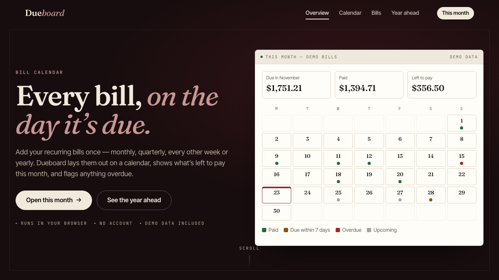
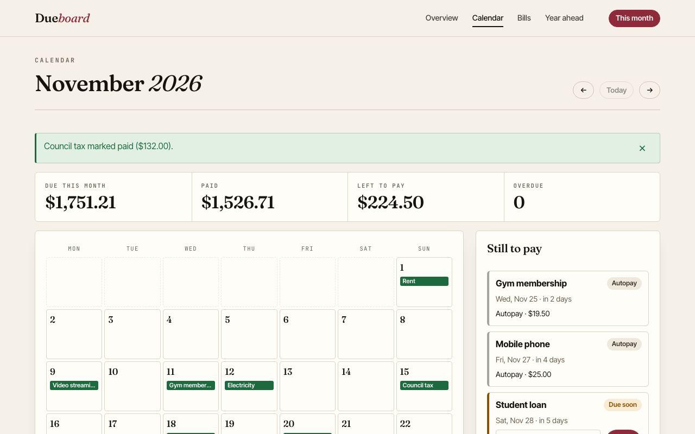
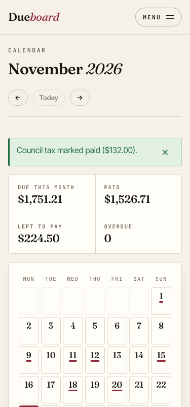

# Dueboard

A calendar of recurring bills — monthly, quarterly, every few weeks or yearly — with what’s paid, what’s left this month, what’s overdue, and what the year ahead will cost.

**Live demo:** [https://dueboard.vercel.app/](https://dueboard.vercel.app/) — runs entirely in your browser; demo data is fictional and labelled.



| Calendar | Mobile |
| --- | --- |
|  |  |

## Run it

```bash
npm install
npm run dev        # http://localhost:5207
npm test
npm run build
npm run test:e2e   # Playwright smoke test (npm run e2e:install once if Chromium is missing)
```

## Main workflow

1. The app opens with ten labelled **demo bills** (fixed, variable, quarterly, fortnightly, yearly and autopay) and three months of payments, with one bill left overdue. **Bills → Clear demo bills** removes them.
2. **Bills → Add bill** → name, payee, category, amount, *amount varies*, *paid automatically*, and a schedule: monthly on a day (every N months from a first month), weekly every N weeks, or yearly on a date. A preview shows the yearly cost and next three dates.
3. **Calendar** → the month at a glance with totals (due, paid, left, overdue). Select a day to see its bills; otherwise the side list shows everything still to pay. Enter the real amount and **Mark paid**, or **Undo**.
4. **Bills** → sortable table with next due date and cost per year, filtered by category; pause or delete a bill.
5. **Year ahead** → amount due in each of the next 12 months (months with a large yearly bill highlighted) and the yearly cost of every bill.

## Rules

- Day 29–31 falls on the last day of shorter months; a 29 February yearly bill is due on 28 February outside leap years.
- Every-N-months bills count from their first month; weekly bills from their first date.
- Autopay bills count as paid once their date passes; manual bills become overdue.
- “Due soon” = within 7 days. Totals use the amount actually paid once a bill is marked paid, otherwise the expected amount.
- Cost per year: monthly × 12 ÷ N, weekly × 52 ÷ N, yearly × 1.

## Design

Shared editorial system: Fraunces display type, Inter Tight interface text, mono weekday labels, status colours (paid green, due-soon amber, overdue red, upcoming neutral) used consistently across calendar chips, dots, list borders and legends, an ink hero whose preview is the real calendar, and a warm paper workspace. Motion is disabled under `prefers-reduced-motion`.

## Tests

- `src/lib/bills.test.ts` — month-end clamping, every-N months, weekly across years, leap-day yearly bills, labels, annual cost, status rules, schedule and summary with actual amounts, month grid, validation.
- `src/App.test.tsx` — calendar with overdue bill, marking paid with a real amount, bad amounts, adding a quarterly bill with preview, year view.
- `e2e/smoke.spec.ts` — landing, pay a bill with reload persistence, add a last-day-of-month autopay bill, year ahead, plus 375px layout checks.

## Limitations

- No reminders or bank connections; it doesn’t pay anything.
- One currency (US dollar formatting).
- Changing a bill’s schedule re-interprets past months.

## Future improvements

- Calendar (.ics) export; price-change history for variable bills.

## Licence

MIT — see [LICENSE](LICENSE).
